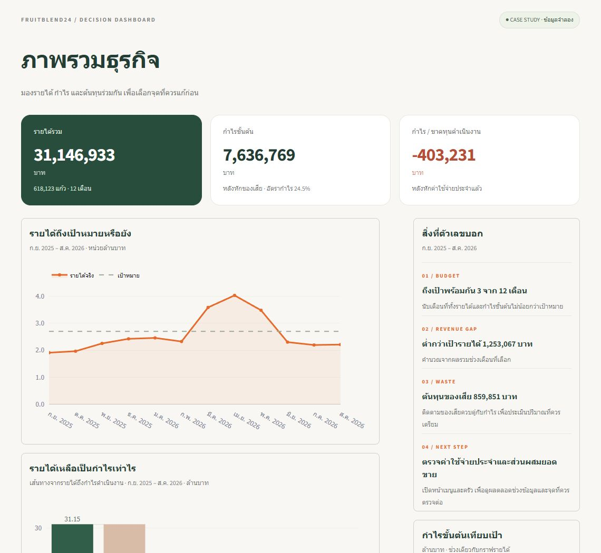
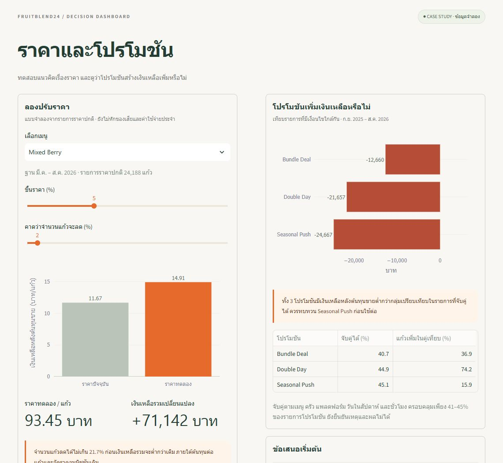
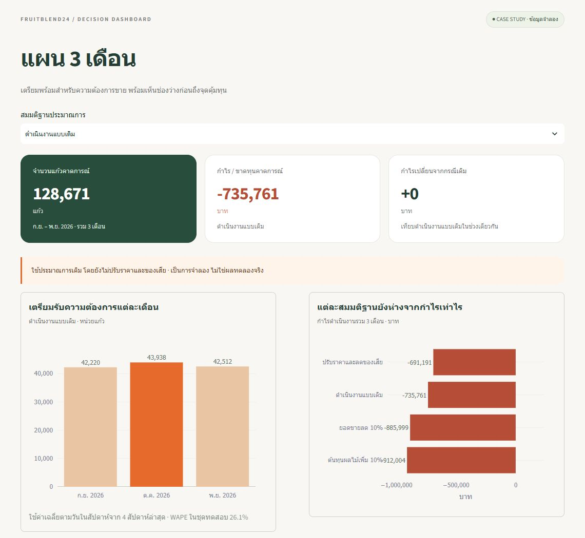

# FruitBlend24 · Business Analytics Dashboard

Dashboard ภาษาไทยสำหรับวิเคราะห์กำไรของธุรกิจเครื่องดื่มผลไม้ ตั้งแต่ผลประกอบการรายเดือน เมนูและครัว ไปจนถึงการทดลองราคาและแผนสินค้าคงคลัง 3 เดือน สร้างด้วย **Python, pandas, NumPy, Plotly และ Streamlit**

โปรเจกต์นี้ต่อยอดจากกรณีศึกษา Data Analyst เพื่อเปลี่ยนผลวิเคราะห์ใน Excel ให้เป็นหน้าจอที่ผู้บริหารสำรวจข้อมูลและเปรียบเทียบทางเลือกได้ด้วยตัวเอง

> ใช้ข้อมูลจำลองจากกรณีศึกษา ผลจริงครอบคลุม ก.ย. 2025 – ส.ค. 2026 และช่วงประมาณการ ก.ย. – พ.ย. 2026 ข้อมูลในแอปเป็น snapshot จาก Excel

## โปรเจกต์นี้ตอบอะไร

ธุรกิจมียอดขาย แต่ยอดขายที่เพิ่มขึ้นอาจไม่ได้ทำให้กำไรเพิ่มตาม Dashboard นี้จึงช่วยดูรายได้ ต้นทุน ของเสีย และค่าใช้จ่ายประจำร่วมกัน เพื่อเลือกจุดที่ควรปรับปรุงก่อน

| คำถามธุรกิจ | สิ่งที่ดูได้ใน Dashboard |
| --- | --- |
| รายได้และกำไรถึงเป้าหมายหรือยัง | เลือกช่วงเดือน ดู KPI แนวโน้มรายได้ และกำไรขั้นต้นเทียบ Budget |
| เมนูและครัวไหนสร้างกำไรหรือขาดทุน | เปรียบเทียบผลประกอบการ และเจาะรายละเอียดของเสียรายเมนูหรือครัว |
| ควรขึ้นราคาหรือใช้โปรโมชันต่อไหม | จำลองราคาและจำนวนแก้วที่ลดลง พร้อมผลเปรียบเทียบโปรโมชัน |
| อีก 3 เดือนจะเป็นอย่างไร | เปรียบเทียบ 4 สมมติฐาน และดูเป้าพร้อมขายรายครัวและเมนู |
| ตัวเลขคำนวณอย่างไร | อ่านนิยาม แหล่งข้อมูล และข้อจำกัดในหน้า “ข้อมูลและวิธีคิด” |

## ตัวอย่างการใช้งาน

### ทดลองราคาและทบทวนโปรโมชัน

เลือกเมนู ปรับเปอร์เซ็นต์ขึ้นราคา และสมมติจำนวนแก้วที่ลดลง เพื่อดูเงินเหลือหลังต้นทุนขายต่อแก้วและผลรวม พร้อมเปรียบเทียบผลของ Bundle Deal, Double Day และ Seasonal Push

การจำลองราคาใช้ต้นทุนต่อแก้วและอัตราคอมมิชชันเดิม ส่วนผลโปรโมชันใช้เฉพาะรายการที่จับคู่กับรายการเปรียบเทียบได้ จึงควรใช้เป็นแนวทางออกแบบการทดลองและวัดผลจริง

### วางแผน 3 เดือน

เปรียบเทียบกรณีดำเนินงานแบบเดิม แผนปรับราคาและลดของเสีย ยอดขายลด 10% และต้นทุนผลไม้เพิ่ม 10% พร้อมกรองตารางเป้าพร้อมขายตามเดือน ครัว และเมนู

ตารางสินค้าคงคลังใช้เป้าพร้อมขายกรณีฐาน รวม safety stock แล้ว ต้องมีสูตรผลิต สต็อกที่ใช้ได้ อายุสินค้า และเวลาส่งก่อนนำไปคำนวณจำนวนซื้อ

## ตัวอย่างข้อค้นพบ

| ผลวิเคราะห์ | ความหมายต่อการตัดสินใจ |
| --- | --- |
| รายได้ 31,146,933 บาท และกำไรขั้นต้น 7,636,769 บาท แต่ขาดทุนดำเนินงาน 403,231 บาท | ควรดูค่าใช้จ่ายประจำร่วมกับกำไรสินค้า ไม่วัดผลจากรายได้เพียงอย่างเดียว |
| แตงโมและสับปะรดสร้างประมาณ 71% ของกำไรขั้นต้นรวม | ควรรักษาความพร้อมขายของสองเมนูนี้ |
| Mixed Berry มีต้นทุนของเสียประมาณ 39% ของต้นทุนของเสียรวม | เป็นจุดที่ควรตรวจปริมาณเตรียมและต้นทุนก่อนขยายยอดขาย |
| แผนปรับปรุงลดขาดทุนคาดการณ์ได้ 44,570 บาท แต่ยังขาดทุน 691,191 บาทใน 3 เดือน | ต้องหาแนวทางเพิ่มกำไรหรือลดค่าใช้จ่ายเพิ่มเติม |

ตัวเลขผลจริงใช้ช่วง ก.ย. 2025 – ส.ค. 2026 ส่วนแผนปรับปรุงใช้ช่วง ก.ย. – พ.ย. 2026 โดยสมมติราคา Mixed Berry เพิ่ม 5% จำนวนแก้วลด 2% และลดต้นทุนของเสียเฉพาะ Mixed Berry 20%

## เทคโนโลยีที่ใช้

| เครื่องมือ | หน้าที่ |
| --- | --- |
| Python, pandas, NumPy | อ่านข้อมูล จัดตาราง คำนวณ KPI และจำลองราคา |
| Streamlit | สร้างหน้าเว็บ ตัวกรอง และส่วนโต้ตอบ |
| Plotly | แสดงกราฟแบบ interactive พร้อมรายละเอียดเมื่อชี้เมาส์ |
| openpyxl | อ่านผลวิเคราะห์จาก Excel |
| Streamlit AppTest | ตรวจการแสดงกราฟ ตาราง และการเปลี่ยนตัวกรอง |

## วิธีเปิดใช้งาน

พัฒนาด้วย Python 3.12 ตัวอย่างคำสั่งด้านล่างสำหรับ Windows PowerShell

~~~powershell
git clone https://github.com/suphakit085/fruitblend24.git
cd fruitblend24
python -m venv .venv-dashboard
.\.venv-dashboard\Scripts\Activate.ps1
python -m pip install -r dashboard/requirements.txt
cd dashboard
python -m streamlit run app.py
~~~

เปิด [http://localhost:8501](http://localhost:8501) ในเบราว์เซอร์

หลังติดตั้งแล้ว ครั้งถัดไปดับเบิลคลิก [Start_Dashboard.cmd](dashboard/Start_Dashboard.cmd) ได้ หรือดูรายละเอียดใน [คู่มือ Dashboard](dashboard/README.md)

## โครงสร้างโปรเจกต์

~~~text
fruitblend24/
├── dashboard/
│   ├── app.py                    # หน้าเว็บ ตัวกรอง และกราฟ
│   ├── data_model.py             # อ่าน Excel ตรวจยอด และจำลองราคา
│   ├── styles.css                # รูปแบบหน้าจอ
│   ├── check_dashboard.py        # ตรวจตัวเลขและการใช้งานหลัก
│   ├── requirements.txt          # Python libraries
│   ├── Start_Dashboard.cmd       # เปิดแอปบน Windows
│   ├── .streamlit/config.toml    # ธีมและการรันในเครื่อง
│   └── data/
│       └── FruitBlend24_Analysis_Results.xlsx
├── docs/images/                  # ภาพแคปจากหน้าเว็บ Streamlit
└── run_dashboard.ps1
~~~

## ข้อมูลและนิยาม

Repository นี้มีโค้ด Dashboard และ Excel ผลวิเคราะห์แบบสรุปที่จำเป็นสำหรับเปิดแอป โดยใช้ข้อมูลขายที่ผ่านการตรวจ 123,655 แถว จากต้นทาง 124,397 แถว และแยกข้อมูลซ้ำ 372 แถวกับสินค้านอกเมนู 370 แถวไว้ในขั้นตอนวิเคราะห์

- **Contribution** คือรายได้หักค่าคอมมิชชัน ผลไม้ บรรจุภัณฑ์ และแรงงาน
- **กำไรขั้นต้น (GP)** คือ Contribution หักต้นทุนของเสีย
- **กำไรดำเนินงาน** คือกำไรขั้นต้นหักค่าใช้จ่ายประจำ
- **อัตราของเสีย** คือจำนวนแก้วทิ้งหารด้วยจำนวนแก้วขายรวมกับแก้วทิ้ง ซึ่งต่างจากสัดส่วนต้นทุนของเสีย

การอัปเดตข้อมูลทำโดยตรวจผลวิเคราะห์ก่อนแทนที่ไฟล์ [FruitBlend24_Analysis_Results.xlsx](dashboard/data/FruitBlend24_Analysis_Results.xlsx) แอปจะอ่านข้อมูลใหม่เมื่อไฟล์เปลี่ยน

## ตรวจการทำงาน

หลังติดตั้ง libraries แล้ว รันจากโฟลเดอร์ dashboard

~~~powershell
python check_dashboard.py
~~~

ชุดตรวจครอบคลุมยอดรายได้และกำไร ตัวกรองเดือน เมนู ครัว และตารางสินค้าคงคลัง การจำลองราคาและจุดคุ้มทุน รวมถึงกราฟและตารางในทั้ง 5 หน้า

## ข้อจำกัด

- ข้อมูลเป็นกรณีศึกษาจำลอง และมีประวัติ 12 เดือน Mixed Berry มีประวัติ 6 เดือน
- Forecast มี WAPE ประมาณ 26.1% ในชุดทดสอบ จึงควรทบทวนประมาณการเป็นระยะ
- ราคาและแผนปรับปรุงเป็นการจำลอง ส่วนโปรโมชันเป็น observational comparison ยังยืนยันเหตุและผลไม่ได้
- เป้าพร้อมขายมีหน่วยเป็นแก้วเทียบเท่า การสั่งซื้อจริงต้องมีข้อมูลวัตถุดิบและสต็อกเพิ่มเติม

## ผู้จัดทำ

**นายศุภกฤต แก้วแกมทอง** · [GitHub](https://github.com/suphakit085) · suphakit.kae@kkumail.com
